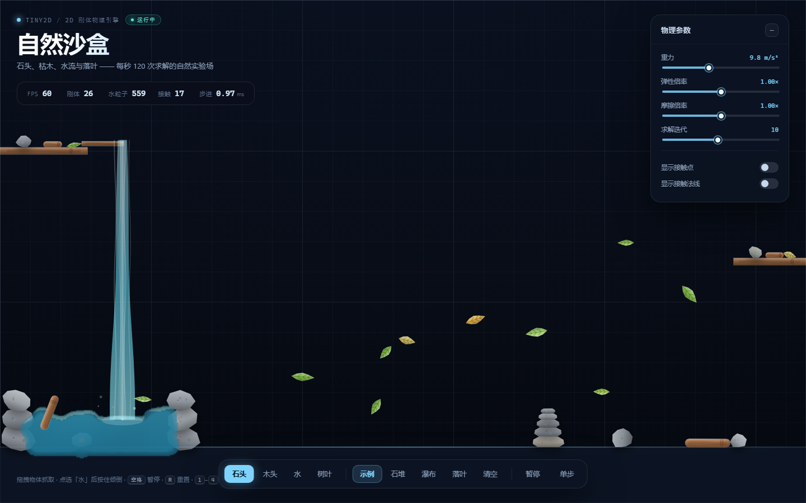
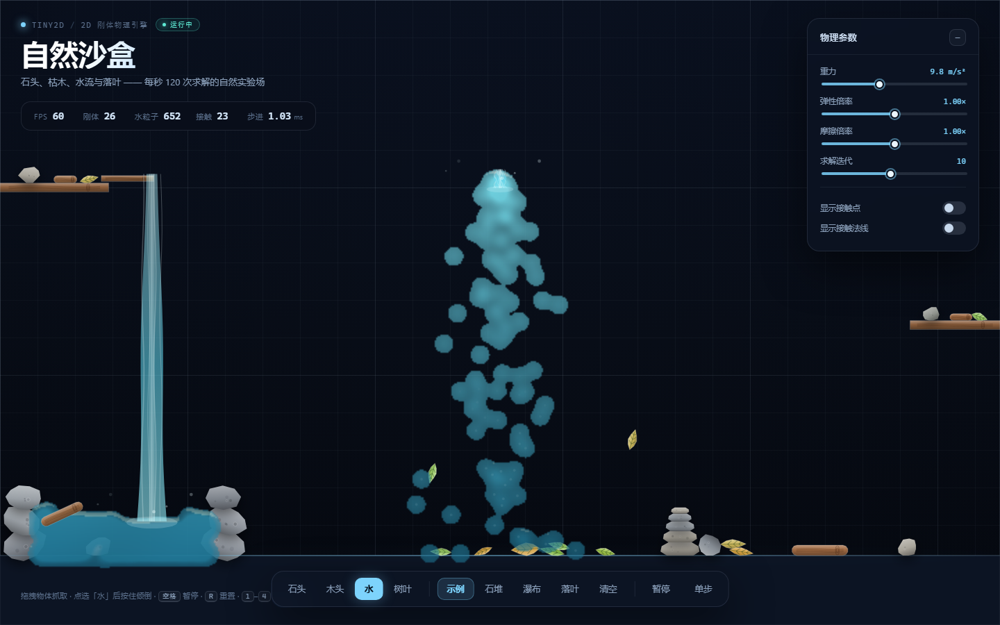
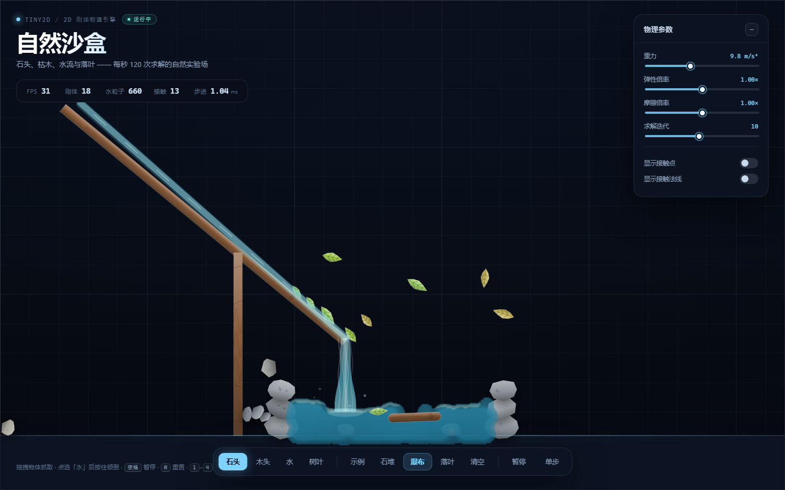
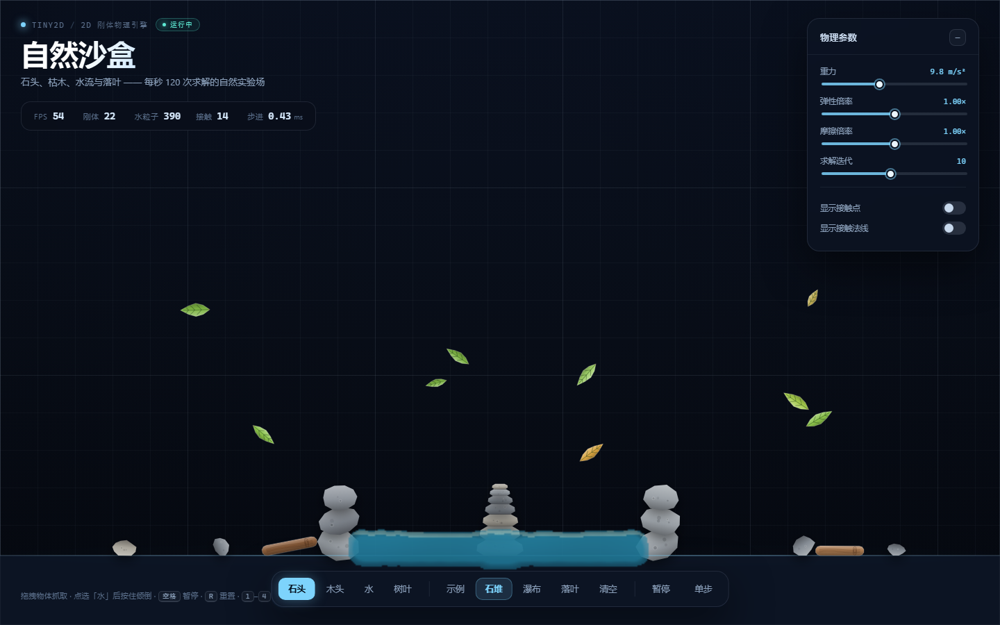
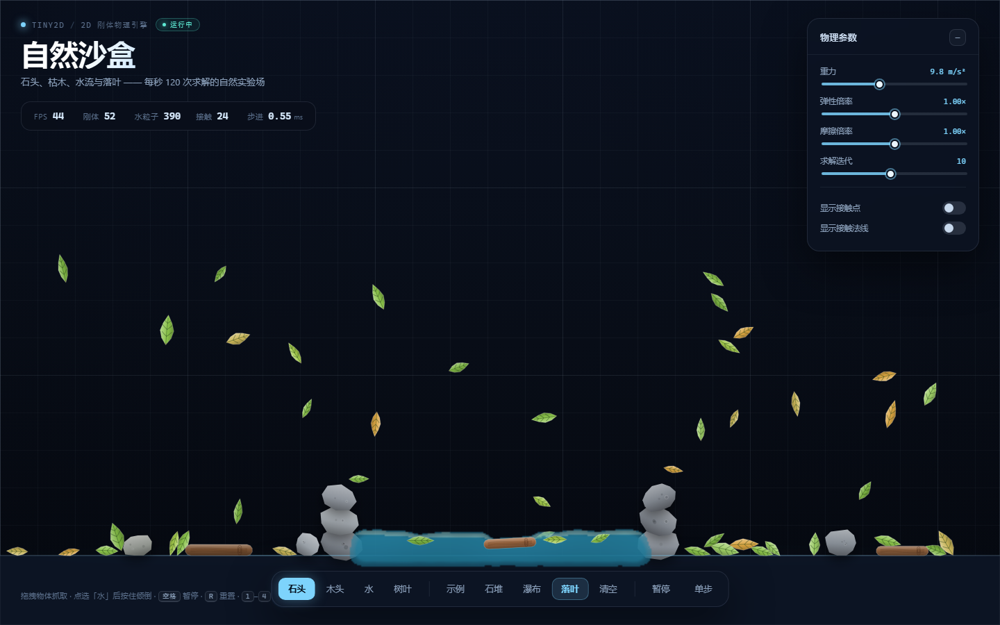
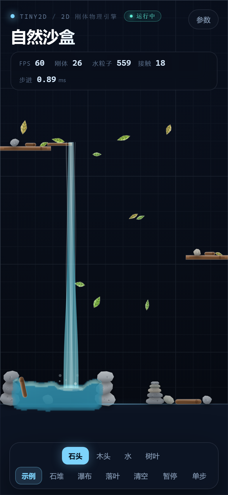
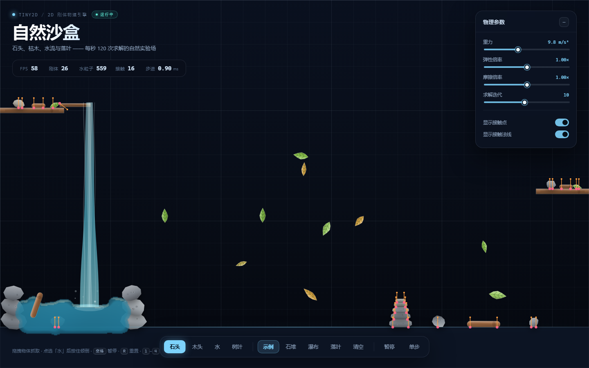

# Tiny2D — 一个可以玩的 2D 自然物理沙盒

一个**零依赖**的 2D 刚性物理引擎，加上一套**真正的粒子流体**（PBF / SPH）：
石头、木头、树叶是刚体，水是上千个粒子互相挤压、流动、溅开、汇成水潭的流体，不再是一颗颗实心圆球。
纯 JavaScript，无构建步骤，双击 HTML 就能玩。



## 快速开始

**直接玩：** 双击 `index.html`（无需服务器、无需安装任何依赖）。

**跑测试：** 需要 Node.js 18+。

```bash
node test.js
# 或者
npm test
```

## 文件结构

```
physics-engine/
├── physics.js          # 2D 刚体物理引擎（无依赖，约 1100 行）
├── nature.js           # 自然物体几何：随机石头 / 扁石 / 原木 / 树叶
├── fluid.js            # 粒子流体：PBF 密度约束 + 空间哈希 + 刚体碰撞
├── index.html          # 自然主题交互沙盒（Canvas 演示）
├── test.js             # 35 个测试，零依赖
├── screenshots/        # 演示截图
├── package.json
├── README.md
└── LICENSE
```

## 四种自然元素

| 元素 | 物理表现 | 视觉 |
| --- | --- | --- |
| **石头** | 高密度、高摩擦、几乎不弹；随机凸多边形轮廓 | 灰色渐变 + 矿物斑点 |
| **木头** | 比石头轻；在水中会浮起来、随水流漂走 | 木纹、端面年轮 |
| **水** | **粒子流体**：会流动、汇合、溅起、托起木头与落叶 | 连续水面、深度渐变、水面高光、瀑布水幕 |
| **树叶** | 极轻、空气阻力大，被微风带着摇摆翻转；落水会浮在水面 | 叶脉、叶柄、绿/金随机叶色 |

交互：

- 选中「石头 / 木头 / 树叶」后，点击空白处生成对应刚体；按住物体可以拖拽
- 选中「水」后，**按住指针持续倒水**；水会真实地流、溅、积成水潭
- 水会托起木头和树叶，让它们漂浮、打转、顺流漂动
- 快捷键：`空格` 暂停，`R` 重置，`1`–`4` 切换元素
- 右侧面板：重力、弹性倍率、摩擦倍率、求解迭代；可显示接触点 / 法线
- 场景预设：示例、石堆、瀑布、落叶、清空
- URL 分享：`index.html?preset=waterfall&sim=2`
  - `preset=showcase|cairn|waterfall|leaves|empty`
  - `sim=2` 预模拟 2 秒；`contacts=1` / `normals=1` / `paused=1` 可选

倒水效果（粒子流体 + 水幕渲染）：



### 场景一览

| 瀑布：木槽引水，循环流入石潭 | 石堆：水池中央的石塔 |
| --- | --- |
|  |  |

| 落叶：树叶旋转飘落、漂在水面 | 移动端 |
| --- | --- |
|  |  |



## 在你的项目里使用

### 刚体引擎（physics.js）

```html
<script src="physics.js"></script>
<script>
  const { Vec2, Body, World, Shapes } = Tiny2D;

  const world = new World({ gravity: new Vec2(0, 9.81) });
  world.addBody(new Body(Shapes.box(20, 1), {
    position: new Vec2(0, 5),
    isStatic: true,
  }));

  const ball = world.addBody(new Body(Shapes.circle(0.5), {
    position: new Vec2(0, 1),
    restitution: 0.6,
  }));

  const FIXED_DT = 1 / 120;
  function loop() {
    world.step(FIXED_DT);
    draw(world); // 你自己的渲染逻辑
    requestAnimationFrame(loop);
  }
  loop();
</script>
```

### 粒子流体（fluid.js）

```js
const { Vec2, Body, World, Shapes } = require('./physics.js');
const Fluid = require('./fluid.js');

const world = new World({ gravity: new Vec2(0, 9.81) });
world.addBody(new Body(Shapes.box(20, 1), {
  position: new Vec2(0, 5),
  isStatic: true,
}));

const fluid = new Fluid({ maxParticles: 1200 });
// 在地板上方填一块水体（间距约 0.09m 时密度接近静止密度）
fluid.fillRect(-2, 1.5, 2, 2.5, 0.09);

const dt = 1 / 120;
for (let i = 0; i < 600; i++) {
  world.step(dt);
  fluid.step(dt, world.bodies); // 水会与刚体碰撞，并把冲量传给动态刚体
}
```

浏览器里先加载 `physics.js` 再加载 `fluid.js`，全局变量为 `Tiny2D` 和 `TinyFluid`；
先加载 `nature.js` 则额外得到自然形状生成器 `TinyNature`。

## API 速查

### 刚体世界 `World`

```js
new World({
  gravity: new Vec2(0, 9.81),
  iterations: 10,
  positionCorrection: 0.2,
  slop: 0.005,
  restitutionThreshold: 1.0,
})
```

| 成员 | 说明 |
| --- | --- |
| `addBody` / `removeBody` / `clear` | 增删刚体 |
| `step(dt)` | 推进一步 |
| `queryPoint(point)` | 拾取包含某点的最上层刚体 |
| `bodies` / `contacts` / `time` / `dynamicBodyCount` | 状态查询 |

### 刚体 `Body` 与形状 `Shapes`

```js
new Body(shape, {
  position, angle, velocity, angularVelocity,
  isStatic, density, mass, inertia,
  restitution, friction, linearDamping, angularDamping, color, userData,
})
```

- 形状：`Shapes.circle(r)`、`Shapes.box(w, h)`、`Shapes.polygon(vertices)`、`Shapes.triangle(w, h)`
- 方法：`localToWorld` / `worldToLocal` / `velocityAtPoint` / `applyImpulse` / `containsPoint`
- 约定：米 / 秒 / 弧度；y 轴向下；接触法线从 bodyA 指向 bodyB

### 自然形状 `TinyNature`

| API | 说明 |
| --- | --- |
| `makeRockShape(radius, flatten, roughness)` | 随机石头 → `{ shape, specks, radius }` |
| `makeFlatStoneShape(radius, thickness, roughness)` | 上下平整的扁石（用于垒石堆） |
| `makeLogShape(length, thickness)` | 胶囊形原木 |
| `makeLeafShape(length, width)` | 两端尖的叶片（凸八边形） |
| `convexHull(points)` | 凸包工具 |

### 流体 `TinyFluid`

```js
const fluid = new TinyFluid({
  h: 0.18,              // 平滑核半径（米）
  restDensity: 3.19,    // 静止密度
  stiffness: 0.2,       // 压力刚度
  iterations: 2,        // 密度约束迭代
  viscosity: 0.02,      // 粘度
  maxParticles: 1100,
  maxSpeed: 12,
  gravity: 9.81,
  coupling: 0.35,       // 水对动态刚体的推力
});

fluid.addParticle(x, y, vx, vy);
fluid.emit(x, y, count, { spread, vx, vy });
fluid.fillRect(x0, y0, x1, y1, spacing);
fluid.step(dt, world.bodies);
fluid.cull(minX, minY, maxX, maxY);
```

## 实现原理

### 刚体部分

1. 半隐式欧拉积分
2. AABB 宽相 → 圆-圆 / 圆-多边形 / 多边形 SAT + 参考面裁剪生成接触流形
3. 顺序冲量求解：法向冲量 + 库仑摩擦 + 热启动 + Baumgarte 位置修正

### 流体部分（fluid.js）

1. 每个水粒子按重力预测位置，用**空间哈希网格**找邻居
2. 用 Poly6 核计算每个粒子的密度，PBF 位置约束：
   `λ = -C / (Σ|∇C|² + ε)`，再按压力梯度修正粒子位置
3. 位置差反推速度，加入 XSPH 粘度
4. 与刚体做粒子级碰撞：圆 / 凸多边形推出、速度反弹与摩擦，并把动量传给动态刚体
5. 演示层额外做了：
   - 木头 / 树叶按浸没比例计算**浮力与水流拖曳**（所以它们会漂、会顺流走）
   - 水面渲染：把粒子密度泼进低分辨率密度场，做**平滑 + 深度渐变 + 水面高光 + 波光**，再平滑放大
   - 瀑布 / 水槽：湿润木槽 + 半透明水幕 + 流动高光；落水点用粒子水花补冲击感。水幕区域不再重复绘制粒子，避免糊成一团团“云”
   - 池壁内部加了**看不见的实体挡墙**，水不会从堆石缝隙里慢慢漏走
   - 水量达到上限后不再新增，**不会为了加新水而挤掉已有的水**
   - 水面泡沫与飞溅粒子

性能：主流桌面浏览器在 500–700 个水粒子 + 30 个刚体时保持 60 FPS；
水粒子物理约 0.6–1.0 ms/物理步（120Hz）。

## 测试

`node test.js` 共 **35 个测试**，覆盖：

- 向量、形状质量属性、质心、自由落体、静止、摩擦、弹性碰撞、动量 / 动能守恒
- 多边形 SAT、裁剪流形、高速不穿透、深度重叠分离、确定性
- 自然形状：凸包、随机石头、扁石、原木、树叶、五块扁石垒塔稳定
- 流体：粒子-圆/多边形碰撞、粒子数量上限、水箱沉降不穿地板且密度合理

当前结果：`35 passed, 0 failed`。

## 已知限制

- 这是**二维**物理：水体是粒子近似，没有真正的体积、表面张力和折射
- 瀑布的连续下落主要由**视觉水幕**表现，粒子只在落点制造水花（纯粒子瀑布在性能预算内会显得稀疏）
- 浮力是演示层的近似模型，不是严格的流固耦合
- 无连续碰撞检测（CCD），极高速物体仍可能穿墙
- 宽相 O(n²)；流体适合几百到一千多粒子；无休眠机制
- 面向学习、演示和游戏原型，不保证工业级精度

## License

[MIT](LICENSE)
